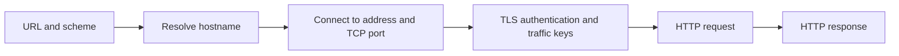

# Module 4: the path from browser to service

[System Administration](system-administration.md) · [Containers](container-fundamentals.md) · [Compose networking](docker-compose.md) · [Nginx reverse proxy](nginx-reverse-proxy.md)

## Course context

The owner supplied this material on 2026-10-11 at 02:33. It introduces Module 4 by connecting a locally running application to external requests. Later sections are described as covering web servers, certificates and system services; their content has not been supplied. The exact title and section number are unknown. Original source text is not stored.

## Ports and endpoints

TCP and UDP ports range from 0 to 65535; port 0 has special allocation semantics rather than being an ordinary service port. A listening endpoint includes an address, transport protocol and port. An IP/port pair alone does not identify a protocol-independent service: TCP and UDP have separate port spaces. Conventional ports include TCP 22 for SSH, 80 for HTTP and 443 for HTTPS. HTTP/3 commonly uses UDP 443.

A service may use another port. URL schemes provide defaults, so `http://host/` normally selects 80 and `https://host/` selects 443. [Linux IP sockets](https://man7.org/linux/man-pages/man7/ip.7.html), [HTTP URI semantics](https://www.rfc-editor.org/rfc/rfc9110.html).

## Listening addresses and reachability

For IPv4, `127.0.0.1` is a loopback address in `127.0.0.0/8`; it refers to the local network namespace. Binding to `0.0.0.0` accepts connections addressed to any local IPv4 address. It is a wildcard bind address, not an external destination to give users. IPv6 uses distinct addresses such as `::1` and `::`; IPv4 binding does not imply IPv6 coverage. [Linux IP sockets](https://man7.org/linux/man-pages/man7/ip.7.html).

Wildcard binding makes a listener eligible to receive external connections, but does not guarantee reachability. Routing, firewalls, NAT, cloud rules and container port publication can still block access. A reverse proxy can intentionally face the network while its upstream application listens only on loopback.

Illustrative Python listener commands, run separately in a disposable directory:

```sh
python3 -m http.server 8765 --bind 127.0.0.1
python3 -m http.server 8765 --bind 0.0.0.0
```

Use `curl http://127.0.0.1:8765/` and the machine's actual LAN address to compare access. A loopback-only listener will not accept a connection addressed to its LAN IP. A wildcard listener can do so if the network permits it. These examples have not been executed; no HTTP status is claimed. Python's simple server serves files from its selected directory and is intended for basic use rather than production hosting. [Python http.server](https://docs.python.org/3/library/http.server.html).

## DNS resolution

DNS is a distributed naming system. A records map names to IPv4 addresses; AAAA records provide IPv6 addresses, and CNAME records express aliases. A resolver can answer from cache or obtain records through the DNS hierarchy. DNS resolution does not prove that an application is healthy. [DNS concepts, RFC 1034](https://www.rfc-editor.org/rfc/rfc1034.html).

```sh
dig +short example.com A
dig +short example.com AAAA
nslookup example.com
```

Multiple answers can support different delivery arrangements, including load distribution. Results depend on time, resolver and location. No current example.com addresses were measured here. Moving a site requires the destination application, certificates and routing to be prepared, plus any DNS changes; caches can retain earlier records until their lifetimes expire.

## HTTP methods, status and headers

GET requests a representation; POST asks a resource to process submitted content. HEAD requests response metadata without a response body. HTTP semantics are distinct from wire format: HTTP/1.x uses textual framing, while HTTP/2 uses binary framing.

| Status class | Meaning | Example |
| --- | --- | --- |
| 1xx | Informational | 100 Continue |
| 2xx | Success | 200 OK |
| 3xx | Redirection | 301 Moved Permanently |
| 4xx | Client error | 404 Not Found |
| 5xx | Server error | 500 Internal Server Error |

Headers describe response properties: `Content-Type` identifies media type; `Last-Modified` can indicate modification time. `Server` is optional and may be omitted or altered. It is a clue rather than proof of origin or architecture. A 404 proves an HTTP response was received; it is different from failure to establish a connection. [HTTP semantics, RFC 9110](https://www.rfc-editor.org/rfc/rfc9110.html).

```sh
curl -I https://example.com/
curl -I https://example.com/nonexistent-page-xyz
curl -v https://example.com/
```

`-I` uses HEAD, so its behavior can differ from GET. `-v` exposes connection and protocol details. Curl's displayed HTTP/2 status text is a human-readable rendering, not an HTTP/1.x status line sent over the wire. Actual protocol, status and headers are not fixed course facts; no live result is recorded. [Curl manual](https://curl.se/docs/manpage.html).

## TLS and certificate identity

In a typical fresh certificate-authenticated TLS 1.3 connection, the handshake authenticates the server and establishes traffic keys. Ephemeral (EC)DHE key agreement and certificate-based signatures have different roles; bulk data uses symmetric authenticated encryption. TLS 1.3 also supports pre-shared keys and session resumption. Optional 0-RTT early data means application data does not universally wait for a fully completed handshake; early data has replay-related limitations. [TLS 1.3, RFC 8446](https://www.rfc-editor.org/rfc/rfc8446.html).

Certificate validation includes chain trust, validity period and matching the intended service identity. Modern hostname matching uses Subject Alternative Name entries; `subject=CN=...` alone is insufficient. Printing certificate fields is not equivalent to validating them. [Service identity, RFC 9525](https://www.rfc-editor.org/rfc/rfc9525.html).

Illustrative TLS inspection with SNI and explicit hostname verification:

```sh
openssl s_client -connect example.com:443 -servername example.com \
  -verify_hostname example.com -verify_return_error </dev/null
```

The verification result depends on the local trust store and actual server chain. SNI identifies the requested virtual host; hostname verification checks its identity. This command was not run. [OpenSSL s_client](https://docs.openssl.org/master/man1/openssl-s_client/).

## Request sequence and diagnosis

For a fresh HTTPS request using HTTP/1.1 or HTTP/2 over TCP:



Cached DNS, reused connections, proxies and TLS resumption can change the steps performed for an individual request. HTTP/3 uses QUIC over UDP with TLS, so TCP is not universal. [HTTP/3, RFC 9114](https://www.rfc-editor.org/rfc/rfc9114.html).

| Symptom | Investigate |
| --- | --- |
| Name does not resolve | Resolver configuration, records, authoritative DNS reachability |
| Connection refused | Destination/port, listener and bind address, explicit network rejection |
| Connection timeout | Routing, filtering, NAT and peer availability |
| TLS validation fails | Hostname, certificate chain, trust store, validity and clock |
| HTTP error response | Requested method/path, proxy behavior and application |

These are starting points, not unique diagnoses. Use `ss -ltnp` on the server to inspect TCP listeners and compare local versus external access. An HTTP proxy forwards requests to an upstream; the observed status can come from either layer.

## Case study: Facebook outage, 4 October 2021

Meta's published account describes a maintenance command that disconnected its backbone; an audit-tool bug failed to block it. DNS locations then withdrew BGP announcements when they lost data-center connectivity, leaving operational authoritative DNS servers unreachable. Network and DNS failures also disabled internal recovery tools. Engineers went onsite, restored connectivity and brought services back carefully. [Meta engineering account, published 2021-10-05](https://engineering.fb.com/2021/10/05/networking-traffic/outage-details/).

The supplied exact outage interval and claims about badge systems or manually resetting servers are not established by that account and are not adopted here. The diagnostic lesson is that routing failure can appear as DNS failure and can affect recovery infrastructure as well as users.

## Recall and learning targets

Minimum: trace the basic request path and explain loopback versus wildcard binding.

Core: explain DNS, interpret status and headers, and identify which layer to investigate.

Advanced: distinguish certificate authentication from traffic encryption and relate bind addresses to routing, filtering and container exposure. These targets summarize the supplied material; no attainment is recorded.

1. Why does binding `0.0.0.0` not guarantee internet access?
2. How do TCP and UDP port spaces differ?
3. Why might a DNS answer be correct while the service is unavailable?
4. How does an HTTP 404 differ from a connection refusal?
5. Why are CN and displayed certificate fields insufficient checks?
6. Which part of the basic sequence changes for HTTP/3?
7. How can a routing incident make authoritative DNS unavailable?

## Verification limits

Official references were consulted on 2026-10-11. Commands are examples, not completed labs or fresh runtime evidence. Dynamic IP addresses, headers, certificates and historical timing from the supplied text are not presented as newly verified values. Course numbering and teaching-environment versions remain unknown; the note remains a draft.
