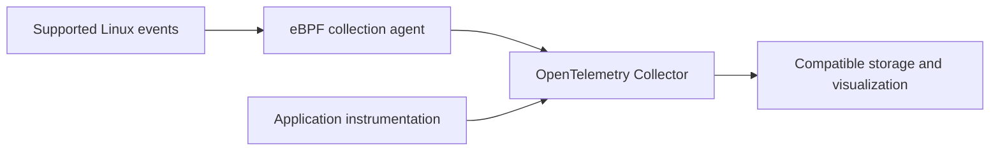

# Optional observability: eBPF and OpenTelemetry

[System Administration](system-administration.md) · [Logs and metrics](service-logs-and-metrics.md)

## Context and evidence

The owner supplied this demonstration section on 2026-10-26.
The material describes it as ungraded and unnecessary for course completion.
Its section number, original author, and source URL are unknown.
The vault retains an English summary, not the original text or output transcript.
No student execution or understanding check was supplied.

## Instrumentation choices

Manual instrumentation adds explicit measurement and tracing calls to application code.
Automatic instrumentation can collect supported operations without source changes.
Runtime agents and library integration can also provide this capability without eBPF.
Automatic coverage depends on the language, framework, and deployment.
See [OpenTelemetry zero-code instrumentation](https://opentelemetry.io/docs/zero-code/).

No source changes does not mean no instrumentation, configuration, overhead, or access requirements.
Business-specific operations can still require explicit spans or measurements.
System events alone cannot explain every internal application step.

## eBPF and its verifier

eBPF runs programs at supported Linux hooks, including tracing and networking hooks.
A verifier checks program behavior before loading.
Its checks restrict memory access and track register and stack state.
This reduces risk. It does not prove that kernel bugs, excessive overhead, or operational failures are impossible.
See [Linux verifier documentation](https://docs.kernel.org/bpf/verifier.html).

Loop support and verification constraints depend on the kernel and program type.
Do not interpret the source's historical loop description as a universal rule for all current kernels.
An eBPF program is not an ordinary process isolated in its own address space.
Tool permissions, available hooks, kernel features, and workload compatibility need checks before use.

Tracing hooks can observe system activity without rebuilding the application.
Some tools can attach to a running process, but deployment requirements differ.
Function-level application tracing is not guaranteed for every executable or runtime.

## Interpreting the supplied bpftrace demonstration

The source describes a two-second count of `sys_enter_openat` events, grouped by `comm`.
`comm` is a task name, not a unique process identifier.
Multiple tasks can share that name.
The count describes syscall entry attempts, not successful file opens.
Other file-opening interfaces are outside that hook's coverage.
See [bpftrace language](https://bpftrace.org/docs/release_024/language).

One displayed task-name group does not prove that only one process opened a file system-wide.
Hook coverage, observation interval, grouping, and event collection limit that inference.
The agent did not repeat the demonstration or validate its reported count.
No privileged tracing program was attached to this host.

## OpenTelemetry signals and components

OpenTelemetry provides specifications, APIs, SDKs, and collection tools for telemetry.
It is more than a single common file format.
Its signals include traces, metrics, and logs.
A trace contains spans that describe operations and their relationships.
A metric describes numerical observations. A log records an event.
See [OpenTelemetry overview](https://opentelemetry.io/docs/what-is-opentelemetry/).

OpenTelemetry does not itself supply the complete storage and visualization backend.
Compatible receivers and exporters connect sources to those systems.
Standard interfaces reduce integration changes, but do not guarantee effortless backend replacement.
Signal support, semantic conventions, and backend capabilities still matter.

## How the technologies combine

A compatible eBPF agent can collect observations and export supported telemetry through OpenTelemetry interfaces.
An OpenTelemetry Collector can receive, process, and export that telemetry.
This is a possible architecture, not behavior supplied by every eBPF tool.
The supplied bpftrace count does not itself demonstrate OpenTelemetry export or distributed tracing.

The diagram shows component roles. It does not record an installed integration.
Encrypted traffic and application-specific meaning can limit what an external collector can infer.

## Recall and learning targets

Minimum: explain how external collection can avoid source changes.
Core: distinguish eBPF collection from OpenTelemetry's telemetry ecosystem.
Advanced: explain verifier limits and identify the additional components required for export.
These are supplied learning targets, not verified student achievements.

1. Why is zero-code collection still instrumentation?
2. What does the verifier check, and what does it not guarantee?
3. Why is grouping by `comm` different from grouping by PID?
4. Does a syscall entry event prove successful completion?
5. Which component stores telemetry for later queries?
6. What would prove that an eBPF tool exports OpenTelemetry data?

## Verification limits

The agent consulted the linked official references on 2026-10-26.
The agent did not install tools, execute bpftrace, or deploy a Collector.
The demonstration remains source-reported evidence. The note remains a draft.

## Related reading

[Isovalent Getting started with eBPF](practice/isovalent-ebpf-getting-started.md) adds a source-based opensnoop study plan and object-inspection tasks.
The PDF does not establish lab completion or an OpenTelemetry integration.
