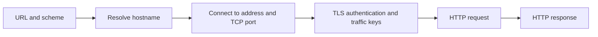

# Module 4: the path from browser to service

[System Administration](system-administration.md) · [Containers](container-fundamentals.md) · [Compose networking](docker-compose.md) · [Nginx reverse proxy](nginx-reverse-proxy.md)

## Course context

The owner supplied this material on 2026-10-11 at 02:33. It introduces external access to a local application. The material names web servers, certificates, and system services as later topics. The owner supplied those topics in later messages. The exact title and section number are unknown. The vault does not store the original source text.

## Ports and endpoints

TCP and UDP ports range from 0 to 65535. Port 0 has a special allocation function. It is not an ordinary service port. A listening endpoint includes an address, transport protocol and port. An IP/port pair alone does not identify a protocol-independent service: TCP and UDP have separate port spaces.

Conventional ports include TCP 22 for SSH, 80 for HTTP and 443 for HTTPS. HTTP/3 usually uses UDP 443.

A service can use another port. URL schemes provide defaults, so `http://host/` normally selects 80 and `https://host/` selects 443. [Linux IP sockets](https://man7.org/linux/man-pages/man7/ip.7.html), [HTTP URI semantics](https://www.rfc-editor.org/rfc/rfc9110.html).

## Listening addresses and reachability

For IPv4, `127.0.0.1` is a loopback address in `127.0.0.0/8`. It refers to the local network namespace. A listener bound to `0.0.0.0` accepts connections to any local IPv4 address. It is a wildcard bind address, not an external destination to give users.

IPv6 uses distinct addresses such as `::1` and `::`. IPv4 binding does not imply IPv6 coverage. [Linux IP sockets](https://man7.org/linux/man-pages/man7/ip.7.html).

A wildcard bind address permits external connections to the listener. It does not guarantee network access.

Routing, firewalls, NAT, cloud rules and container port publication can still block access. A reverse proxy can intentionally face the network while its upstream application listens only on loopback.

Example Python listener commands, run separately in a disposable directory:

```sh
python3 -m http.server 8765 --bind 127.0.0.1
python3 -m http.server 8765 --bind 0.0.0.0
```

First use `curl http://127.0.0.1:8765/` to check loopback access. Then repeat the request with the machine's actual LAN address. A loopback-only listener will not accept a connection addressed to its LAN IP. A wildcard listener can do so if the network permits it. The agent did not execute these examples.

This note does not record an observed HTTP status. Python's simple server serves files from the selected directory. Do not use it as a production web server. [Python http.server](https://docs.python.org/3/library/http.server.html).

## DNS resolution

DNS is a distributed naming system. A records map names to IPv4 addresses. AAAA records provide IPv6 addresses, and CNAME records express aliases. A resolver can answer from cache or obtain records through the DNS hierarchy. DNS resolution does not prove that an application is healthy. [DNS concepts, RFC 1034](https://www.rfc-editor.org/rfc/rfc1034.html).

```sh
dig +short example.com A
dig +short example.com AAAA
nslookup example.com
```

Multiple answers can support different delivery arrangements, including load distribution. Results depend on time, resolver and location. The agent did not measure current example.com addresses. Before a site move, prepare the destination application, certificates, and routing. Then make the necessary DNS changes. Caches can keep old records until expiry.

## HTTP methods, status and headers

GET requests a resource representation. POST asks a resource to process supplied content. HEAD requests response metadata without a response body. HTTP semantics and message format are different. HTTP/1.x uses text framing. HTTP/2 uses binary framing.

| Status class | Meaning | Example |
| --- | --- | --- |
| 1xx | Informational | 100 Continue |
| 2xx | Success | 200 OK |
| 3xx | Redirection | 301 Moved Permanently |
| 4xx | Client error | 404 Not Found |
| 5xx | Server error | 500 Internal Server Error |

Headers describe response properties: `Content-Type` identifies media type. `Last-Modified` can indicate modification time. The server can omit or change the optional `Server` header. It is a clue rather than proof of origin or architecture.

A received 404 is an HTTP response. It is not a connection failure. [HTTP semantics, RFC 9110](https://www.rfc-editor.org/rfc/rfc9110.html).

```sh
curl -I https://example.com/
curl -I https://example.com/nonexistent-page-xyz
curl -v https://example.com/
```

`-I` uses HEAD, so its behavior can differ from GET. `-v` exposes connection and protocol details. Curl shows HTTP/2 status as readable text. HTTP/2 does not send that text as an HTTP/1.x status line.

Protocol, status, and headers can change between requests. The agent did not measure them for this note. [Curl manual](https://curl.se/docs/manpage.html).

## TLS and certificate identity

In a typical fresh certificate-authenticated TLS 1.3 connection, the handshake authenticates the server and shows traffic keys. Ephemeral (EC)DHE key agreement and certificate-based signatures have different roles. Bulk data uses symmetric authenticated encryption. TLS 1.3 also supports pre-shared keys and session resumption.

Optional 0-RTT permits early application data before handshake completion. Early data has replay-related limits. [TLS 1.3, RFC 8446](https://www.rfc-editor.org/rfc/rfc8446.html).

Certificate validation includes chain trust, validity period and matching the intended service identity. Modern hostname checks use Subject Alternative Name entries. The CN alone does not meet this requirement. A certificate display does not validate the certificate. [Service identity, RFC 9525](https://www.rfc-editor.org/rfc/rfc9525.html).

Example TLS inspection with SNI and explicit hostname verification:

```sh
openssl s_client -connect example.com:443 -servername example.com \
  -verify_hostname example.com -verify_return_error </dev/null
```

The verification result depends on the local trust store and actual server chain. SNI identifies the requested virtual host. Hostname verification checks its identity. The agent did not execute this command. [OpenSSL s_client](https://docs.openssl.org/master/man1/openssl-s_client/).

## Request sequence and diagnosis

For a fresh HTTPS request using HTTP/1.1 or HTTP/2 over TCP:



DNS caches, reused connections, proxies, and TLS resumption can change the steps for a request. HTTP/3 uses QUIC over UDP with TLS, so TCP is not universal. [HTTP/3, RFC 9114](https://www.rfc-editor.org/rfc/rfc9114.html).

| Symptom | Investigate |
| --- | --- |
| Name does not resolve | Resolver configuration, records, authoritative DNS reachability |
| Connection refused | Destination/port, listener and bind address, explicit network rejection |
| Connection timeout | Routing, filtering, NAT and peer availability |
| TLS validation fails | Hostname, certificate chain, trust store, validity and clock |
| HTTP error response | Requested method/path, proxy behavior and application |

These are starting points, not unique diagnoses. Use `ss -ltnp` on the server to inspect TCP listeners. Compare local access with external access. An HTTP proxy forwards requests to an upstream. The observed status can come from either layer.

## Case study: Facebook outage, 4 October 2021

Meta's published account describes a maintenance command that disconnected its backbone. An audit-tool bug failed to block it. DNS locations lost data-center connectivity and withdrew BGP announcements. Their authoritative DNS servers still operated, but external systems could not reach them.

Network and DNS failures also disabled internal recovery tools. Engineers went to the sites. They restored connectivity and returned the services to operation in controlled steps. [Meta engineering account, published 2021-10-05](https://engineering.fb.com/2021/10/05/networking-traffic/outage-details/).

That account does not confirm the supplied exact outage interval, badge-system claims, or manual server resets. This note does not adopt those details. The diagnostic lesson is that routing failure can appear as DNS failure and can affect recovery infrastructure as well as users.

## Recall and learning targets

Minimum: trace the basic request path and explain loopback versus wildcard binding.

Core: explain DNS, interpret status and headers, and identify which layer to investigate.

Advanced: distinguish certificate authentication from traffic encryption and relate bind addresses to routing, filtering and container exposure. These targets summarize the supplied material. The student did not report completion.

1. Why does binding `0.0.0.0` not guarantee internet access?
2. How do TCP and UDP port spaces differ?
3. Why might a DNS answer be correct while the service is unavailable?
4. How does an HTTP 404 differ from a connection refusal?
5. Why are CN and displayed certificate fields not sufficient checks?
6. Which part of the basic sequence changes for HTTP/3?
7. How can a routing incident make authoritative DNS unavailable?

## Verification limits

The agent read the official references on 2026-10-11. Commands are examples, not completed labs or fresh runtime evidence. This note does not claim a new check of supplied IP addresses, headers, certificates, or outage times. Course numbering and teaching-environment versions remain unknown. The note remains a draft.
